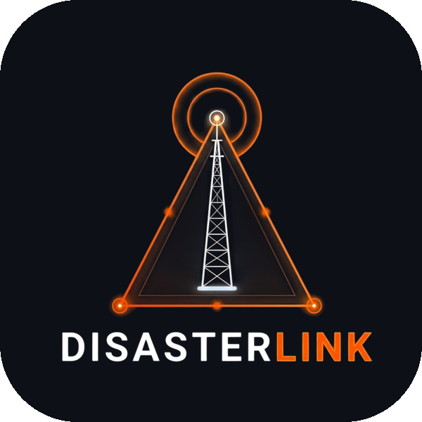
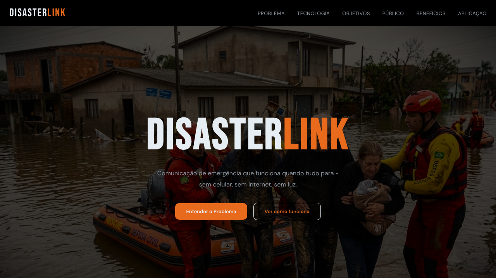
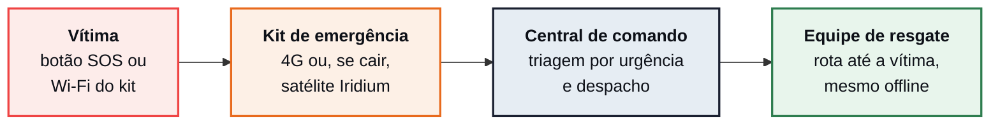

# DisasterLink

**Comunicação de emergência que funciona quando tudo para.**

Sistema que garante comunicação de emergência mesmo sem internet ou sinal de celular.

Global Solution 2026.1 · Space Connect · FIAP · Engenharia de Software

---

## O problema

Quando uma enchente, um desabamento ou um incêndio acontece, a comunicação costuma cair junto: sem sinal de celular, sem internet e, muitas vezes, sem luz. As vítimas não conseguem pedir socorro, as equipes de resgate não sabem para onde ir e a Defesa Civil coordena as ações às cegas. Foi o que aconteceu no Rio Grande do Sul em 2024, quando municípios inteiros ficaram dias sem comunicação.

## A solução

O **DisasterLink** mantém esse canal aberto. Um **kit de emergência portátil** é levado até a área do desastre. A vítima pede socorro conectando o celular ao Wi-Fi do kit ou apertando um botão SOS com rádio LoRa, que alcança até 5 km. O kit envia o pedido, com a localização, pela rede 4G ou, quando ela falha, pelo **satélite Iridium**, que funciona em qualquer lugar do planeta.

Na outra ponta, a Defesa Civil vê as vítimas num mapa em tempo real, ordenadas pela urgência, e despacha a equipe mais próxima. Os resgatadores usam um app que funciona offline, e os casos médicos graves geram alertas automáticos no WhatsApp.

O objetivo é simples: que nenhum pedido de socorro se perca quando a comunicação cai, e que o resgate chegue primeiro a quem mais precisa.

---

## As partes do projeto

| Repositório | O que é | Tecnologias | Disciplina |
|---|---|---|---|
| [**kit-de-emergencia**](https://github.com/SpaceConnect-DisasterLink/kit-de-emergencia) | Simulação do kit: recebe o SOS, tenta o 4G e usa o satélite quando ele falha | Arduino · C++ · Wokwi | Edge Computing & Computer Systems |
| [**central-de-comando**](https://github.com/SpaceConnect-DisasterLink/central-de-comando) | Central no terminal para triagem das vítimas por urgência, canais de comunicação e despacho das equipes | Python | Computational Thinking with Python |
| [**landing-page**](https://github.com/SpaceConnect-DisasterLink/landing-page) | Página que apresenta o problema, a solução e quem ela ajuda ([ver online](https://disasterlink-landing.vercel.app)) | HTML · CSS | Front-End Design |
| [**site-interativo**](https://github.com/SpaceConnect-DisasterLink/site-interativo) | Versão do site com slideshow, quiz, formulário de contato e troca de tema ([ver online](https://disasterlink-site.vercel.app)) | HTML · CSS · JavaScript | Web Development |

### Os números da solução

| Item | Valor |
|---|---|
| Alcance do botão SOS (LoRa) | Até 5 km |
| Confirmação de recebimento | Menos de 3 minutos |
| Canal principal | Rede 4G |
| Canal de emergência | Satélite Iridium, com troca automática |
| Prioridade do resgate | Score de urgência de 0 a 100 para cada vítima |

---

> **Importante:** o DisasterLink é um **protótipo acadêmico**. Os módulos de rádio, GPS, 4G e satélite são simulados, e pessoas, equipes e coordenadas do projeto são **fictícias**.

---

## Equipe

| Nome | RM |
|------|----|
| Caique Kenji Yafuco | 570368 |
| Guilherme Tomé Nogueira | 570144 |
| Lucas de Andrade Astorini | 569119 |
| Sabrina Lopes da Silva | 571870 |
| Sofia Satomi Hagio | 569120 |
